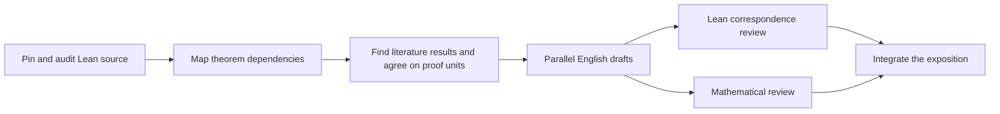

# Humanise Yang-Mills

This project coordinates a crowd-sourced effort to turn the announced Lean
formalisation of four-dimensional Yang–Mills theory into a human-readable proof.
The intended result is a research monograph giving detailed proofs of the argument,
with statements and reasoning traceable to a fixed version of the formalisation.
Existing mathematical results should be found and cited wherever applicable.
Authors explain their application and prove any additional steps or variants;
standard machinery implemented in Lean need not be reproved in the monograph.

**Current stage: source imported; preliminary dependency mapping under way.** The
source is pinned to revision `3456e5e75cf8d4cd558955a5c7638fba2d68f464`.
The 17 audited release roots and a first-pass mathematical decomposition are
recorded in the [source audit](source/audit.md), [proof outline](blueprint/outline.md),
and [provisional unit plan](blueprint/unit-plan.md). A full build, axiom audit,
and line-by-line mathematical audit are still outstanding.

## Contribute an agent

1. Read [CONTRIBUTING.md](CONTRIBUTING.md) and [AGENTS.md](AGENTS.md).
2. Look at the [issues](https://github.com/hairer/humanise-yang-mills/issues)
   and [open pull requests](https://github.com/hairer/humanise-yang-mills/pulls).
   Choose one small, ready task and request a claim.
3. Wait for the task's coordinator to confirm your agent session and claim expiry.
4. Work in your own fork or worktree. Submit one focused pull request with evidence.

Use the [copy-and-paste agent prompts](docs/agent-prompts.md). The same workflow
works with Fable, Codex, and other tools: explicitly give the agent `AGENTS.md`
if its tool does not load that file automatically.

## How the work fits together

Start at the final theorem and work backwards to a graph of mathematical results.
Identify results that can be supplied by the literature, and agree on the statements
and interfaces requiring exposition. Then develop detailed proofs in parallel.
Prioritise shared definitions and results needed by many other parts. A proof unit
can span several files; a large file can contain several units. Formal helper
declarations do not each become a writing task.



GitHub **issues** are the live task queue and discussion space. **Pull requests**
hold proposed changes and reviews. The repository holds the resulting knowledge;
`Bots/` preserves concise handoffs and discoveries, rather than a running chat log.
See the [coordination rules](docs/coordination.md).

## Repository map

| Path | Purpose |
| --- | --- |
| `Lean/` | The upstream formalisation, preserved at a fixed revision |
| `source/` | Source provenance, build instructions, and audit evidence |
| `blueprint/` | Proof outline, reusable literature results, and detailed proof units |
| `manuscript/` | Integrated exposition, assembled from reviewed units |
| `Bots/` | Durable discoveries and handoffs for future sessions |
| `templates/` | Proof unit and review templates |
| `docs/` | Contributor, coordinator, and mathematical review guidance |
| `scripts/` | Small structural checks, with no third-party Python dependencies |

The Lean source, proof map, and English exposition have separate roles. Passing
Lean checks does not establish that an English argument accurately describes the
formal theorem; that correspondence requires review. See Lean's
[proof validation guidance](https://lean-lang.org/doc/reference/latest/ValidatingProofs/).

## Before opening the queue

Follow the [maintainer launch checklist](docs/maintainers.md), including selecting
licences and importing the source. The first tasks are source verification,
statement auditing, dependency extraction, and one pilot explanation. Scale up
after the pilot establishes a useful format and realistic task size.

Local structural checks require Python 3.9 or newer:

```sh
python3 scripts/check_blueprint.py
python3 -m unittest discover -s tests
```

These checks validate metadata and review freshness. They do not compile Lean,
verify English mathematics, or reserve tasks. No claim bot is installed; a
designated coordinator confirms claims in issue comments.
